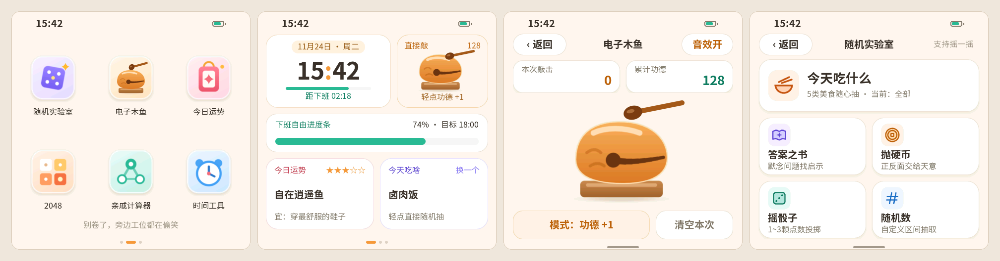

# 摸鱼搭子 Desk Buddy

运行在 Waveshare ESP32-S3-Touch-AMOLED-2.16 上的桌面小玩具固件。开机即用，日常离线运行。

<p align="center">
  <a href="docs/assets/desk-buddy-cover.webp"></a>
</p>

## 功能

- **随机实验室**：今天吃什么、答案之书、抛硬币、摇骰子、随机数，支持摇一摇
- **电子木鱼**：敲击动画与音效，累计功德
- **今日运势**：摸鱼指数、幸运色、宜忌与签文，每天更新
- **2048**：自动保存进度和最高分
- **亲戚计算器**：常见亲属称呼推算
- **时间工具**：时钟、番茄钟、上下班倒计时
- **系统设置**：亮度、音量、护屏、摇一摇灵敏度、校时

主屏向右滑进入负一屏（时钟、下班进度、运势），向左滑进入设置，应用内从底部上滑返回桌面。顶部三颗实体按键从左到右：短按依次为返回/切页、亮/熄屏、敲木鱼或抽签；长按依次为静音、电源菜单、系统设置。

校时：进入「设置 → 时间与校时」，用手机相机扫码连接 `DeskBuddy-XXXX` 开放热点，按 UTC+8 同步手机时间或配置 Wi-Fi。配网页没有自动弹出时，在手机浏览器打开 `http://192.168.4.1/`。

## 烧录

固件只支持 Waveshare ESP32-S3-Touch-AMOLED-2.16。从 [Releases](https://github.com/Waveshare-wulu/desk-buddy/releases) 下载后，用 [Waveshare Hub](https://hub.waveshare.net/) 网页烧录，或运行：

```sh
python -m esptool --chip esp32s3 --port <串口> write-flash 0x0 desk-buddy-<版本>-esp32-s3-touch-amoled-2.16-merged.bin
```

合并镜像会清除设置和存档。升级时要保留数据，按发布包中 `manifest.json` 的地址分段烧录，不要擦除 Flash。

## 构建

需要 [ESP-IDF v6.1](https://docs.espressif.com/projects/esp-idf/zh_CN/v6.1/esp32s3/get-started/index.html)。

```sh
idf.py build
idf.py -p <串口> flash monitor
```

更多说明：[架构](docs/ARCHITECTURE.md) · [测试](docs/TESTING.md)

## 许可

[Apache-2.0](LICENSE)。第三方组件与字体的许可见 [THIRD_PARTY.md](docs/THIRD_PARTY.md)。
